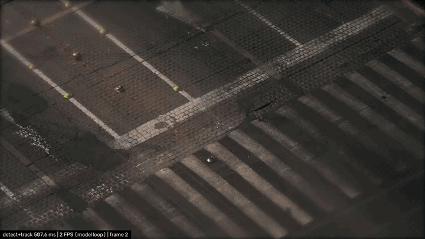
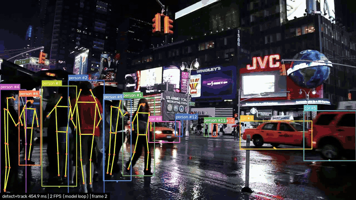
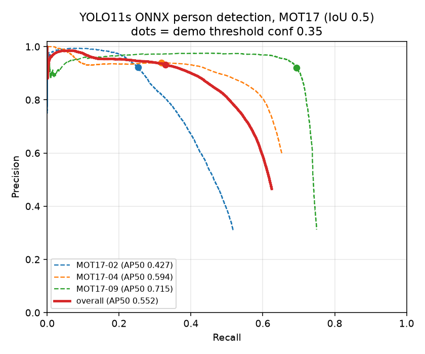
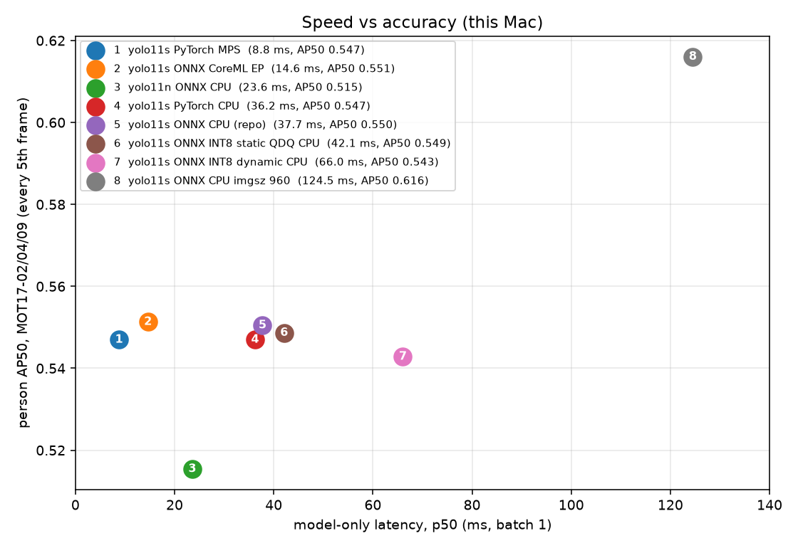
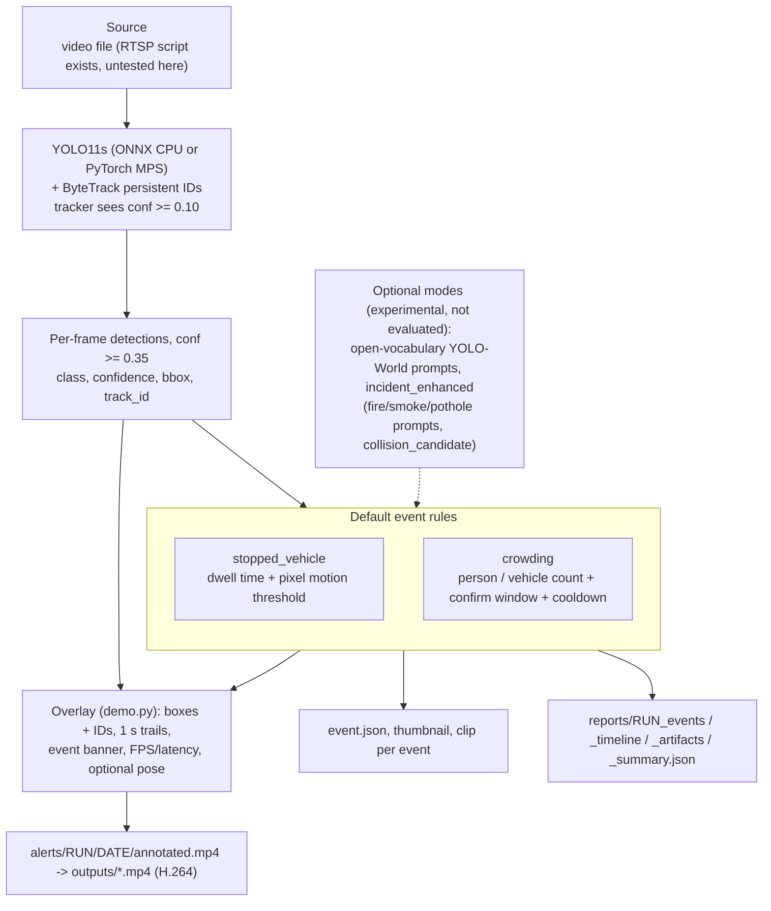

# city-incident-ai



Video analytics for city cameras: YOLO11s detection and ByteTrack tracking on a video file, rule-based events, and an annotated H.264 video plus JSON outputs. The default pipeline uses COCO-pretrained weights (no fine-tuning), tracks people and vehicles (`person, bicycle, car, motorcycle, bus, truck`), and runs two event rules, `stopped_vehicle` (dwell time + pixel-motion threshold) and `crowding` (person count). On an Apple M5 the full pipeline (decode, detect, track, rules, draw, write) ran at 48.1 FPS with PyTorch on the GPU (MPS) and 21.1 FPS with the ONNX model on CPU (300 frames of one clip; see Speed vs accuracy). Person detection and tracking are evaluated on MOT17; the event rules have no event-level ground truth yet. See [Limitations](#limitations) and [docs/ERROR_ANALYSIS.md](docs/ERROR_ANALYSIS.md).



*`--pose` adds yolo11n-pose skeletons; the red banner is the `crowding` event firing.*

## Results

Quality metrics for the default demo detector (`yolo11s.onnx`, `imgsz` 640, NMS IoU 0.5, person class) on the
**MOT17 train** static-camera sequences MOT17-02, MOT17-04 and MOT17-09 (FRCNN folders; `gt.txt` is the same for
all three detector variants). Every number below is rendered from `reports/metrics/detection.json` and
`reports/metrics/tracking.json` by `eval/make_results_md.py`.

### Detection (person, IoU 0.5 unless noted)

| Sequence | GT boxes | AP50 | AP50:95 | P @0.35 | R @0.35 | best-F1 thr | best F1 (P / R) |
|---|---:|---:|---:|---:|---:|---:|---|
| MOT17-02 | 18581 | 0.427 | 0.225 | 92.2% | 25.2% | 0.082 | 0.502 (65.3% / 40.8%) |
| MOT17-04 | 47557 | 0.594 | 0.328 | 93.9% | 31.8% | 0.031 | 0.688 (80.2% / 60.2%) |
| MOT17-09 | 5325 | 0.715 | 0.427 | 92.0% | 69.4% | 0.370 | 0.792 (92.7% / 69.1%) |
| overall | 71463 | 0.552 | 0.303 | 93.3% | 32.9% | 0.055 | 0.628 (74.5% / 54.2%) |

Recall at conf 0.35 by GT visibility and box height (all three sequences pooled):

| Bucket | GT boxes | Detected | Recall |
|---|---:|---:|---:|
| visibility <0.3 | 22627 | 831 | 3.7% |
| visibility 0.3-0.7 | 18826 | 3226 | 17.1% |
| visibility >0.7 | 30010 | 19442 | 64.8% |
| height <50 px | 1276 | 0 | 0.0% |
| height 50-100 px | 8149 | 595 | 7.3% |
| height >100 px | 62038 | 22904 | 36.9% |

### Tracking (person, conf 0.35, same detections for both trackers)

| Tracker | Sequence | MOTA | IDF1 | IDsw | FP | FN | MT | ML | Pred IDs / GT IDs |
|---|---|---:|---:|---:|---:|---:|---:|---:|---|
| ByteTrack | MOT17-02 | 22.9% | 32.3% | 37 | 322 | 13976 | 8 | 39 | 84 / 62 |
| ByteTrack | MOT17-04 | 29.0% | 42.2% | 49 | 1033 | 32661 | 8 | 45 | 99 / 83 |
| ByteTrack | MOT17-09 | 61.6% | 56.7% | 44 | 295 | 1706 | 9 | 4 | 54 / 26 |
| ByteTrack | OVERALL | 29.9% | 41.2% | 130 | 1650 | 48343 | 25 | 88 | 237 / 171 |
| BoT-SORT (no ReID) | MOT17-02 | 22.8% | 31.1% | 41 | 330 | 13979 | 8 | 39 | 85 / 62 |
| BoT-SORT (no ReID) | MOT17-04 | 29.4% | 43.1% | 46 | 961 | 32588 | 9 | 45 | 98 / 83 |
| BoT-SORT (no ReID) | MOT17-09 | 63.2% | 58.9% | 42 | 254 | 1661 | 10 | 4 | 52 / 26 |
| BoT-SORT (no ReID) | OVERALL | 30.2% | 41.7% | 129 | 1545 | 48228 | 27 | 88 | 235 / 171 |

Tracker-only time per frame (mean, ms; excludes the detector):

| Tracker | MOT17-02 | MOT17-04 | MOT17-09 | overall |
|---|---:|---:|---:|---:|
| ByteTrack | 0.99 | 1.45 | 0.93 | 1.20 |
| BoT-SORT | 9.16 | 10.64 | 9.65 | 9.99 |



Alignment sanity checks (GT green, predictions red, ignore regions yellow, 3 random frames per sequence) are in
`docs/eval_check/`.

### Detector threshold vs ByteTrack (person, MOT17-02/04/09 pooled)

ByteTrack's stock `bytetrack.yaml` has `track_high_thresh 0.25`, `track_low_thresh 0.1`, `new_track_thresh 0.25`, `track_buffer 30`. Its second association pass uses boxes scoring between 0.1 and 0.25, so a detector run at conf 0.35 never feeds it anything. The tracker is given the lower-confidence boxes while drawing and events still use only boxes >= 0.35 (`tracking.detector_conf` vs `runtime.score_threshold`).

| Config | MOTA | IDF1 | IDsw | FP | FN | MT | ML | Pred IDs / GT IDs | Recall <0.3 vis | 0.3-0.7 vis | >0.7 vis |
|---|---:|---:|---:|---:|---:|---:|---:|---|---:|---:|---:|
| a: detector conf 0.35, stock yaml (previous demo) | 29.9% | 41.2% | 130 | 1650 | 48343 | 25 | 88 | 237 / 171 | 3.4% | 16.4% | 64.2% |
| b: detector conf 0.10, stock yaml (new demo default) | 35.7% | 44.8% | 156 | 2465 | 43351 | 29 | 80 | 288 / 171 | 5.2% | 21.4% | 76.4% |
| c: detector conf 0.10, `track_buffer: 60` | 35.7% | 45.0% | 157 | 2463 | 43325 | 29 | 80 | 282 / 171 | 5.2% | 21.4% | 76.4% |

Per-sequence numbers: `reports/metrics/tracking_conf_ablation.json` (`python -m eval.eval_tracking --conf-ablation`). Recall by visibility is computed from tracker output (Hungarian match, IoU >= 0.5), not from raw detections.

Lowering the detector conf from 0.35 to 0.10 raised MOTA and IDF1 and the share of GT boxes covered at every visibility level, at the cost of more false positives, more ID switches and more predicted identities. Raising `track_buffer` to 60 changed the overall result very little compared with b, and MOT17-09 alone scored slightly lower under b and c than under a (see the JSON).

On the demo clips, unique drawn track IDs went from 30 to 34 (clip 61) and from 172 to 193 (clip 4332); these clips have no ground truth, so this is not an accuracy measure (`reports/metrics/track_counts_lowconf.json`).

### Speed vs accuracy (this Mac, batch 1)

Hardware/software: Apple M5 (10 cores), 16.0 GB, macOS 26.6, Python 3.12.14, torch 2.15.0, onnxruntime 1.31.1, ultralytics 8.4.202.

| Variant | imgsz | size MB | model-only ms mean / p50 / p95 | detector total p50 ms | pipeline FPS | AP50 | recall@0.35 h<50 | 50-100 | >100 |
|---|---:|---:|---|---:|---:|---:|---:|---:|---:|
| yolo11s PyTorch CPU | 640 | 18.4 | 40.8 / 36.2 / 59.9 | 37.1 | 22.2 | 0.547 | 0.0% | 6.4% | 35.9% |
| yolo11s PyTorch MPS | 640 | 18.4 | 9.9 / 8.8 / 14.5 | 10.6 | 48.1 | 0.547 | 0.0% | 6.4% | 35.9% |
| yolo11s ONNX CPU (repo) | 640 | 36.3 | 42.4 / 37.7 / 70.6 | 39.2 | 21.1 | 0.550 | 0.0% | 6.9% | 36.7% |
| yolo11s ONNX CoreML EP | 640 | 36.3 | 14.3 / 14.6 / 15.8 | 18.8 | 29.2 | 0.551 | 0.0% | 6.9% | 37.2% |
| yolo11s ONNX INT8 static QDQ CPU | 640 | 9.8 | 44.1 / 42.1 / 58.4 | 44.8 | 17.7 | 0.549 | 0.0% | 6.5% | 36.9% |
| yolo11s ONNX INT8 dynamic CPU | 640 | 9.4 | 68.6 / 66.0 / 83.7 | 67.6 | 10.8 | 0.543 | 0.0% | 6.9% | 37.3% |
| yolo11n ONNX CPU | 640 | 10.2 | 25.1 / 23.6 / 35.4 | 25.2 | 32.6 | 0.515 | 0.0% | 5.6% | 34.0% |
| yolo11s ONNX CPU imgsz 960 | 960 | 36.5 | 128.8 / 124.5 / 164.2 | 127.8 | 8.0 | 0.616 | 0.8% | 15.1% | 48.6% |

- **Model-only** = wall time of the backend forward pass (MPS synchronised; letterbox and NMS excluded), 300 frames of `data/videos/mixkit-61.mp4` after 20 warm-up frames. **Detector total** adds preprocessing and NMS. **Pipeline FPS** = the normal demo path (decode + detect + ByteTrack + rules + draw + write mp4) over the first 300 frames of the same clip, tracker `detector_conf` 0.1 / display 0.35.
- **Accuracy** uses MOT17-02/04/09 (FRCNN folders) **every 5th frame only** (435 frames, 14,287 GT person boxes), person class, conf floor 0.01, NMS IoU 0.5, same matcher and AP code as `eval/eval_detection.py`. Recall columns are at conf 0.35 by GT box height (254 / 1,632 / 12,401 boxes). Because of the frame subset, AP50 for the repo model is 0.550 here vs 0.552 in the full evaluation above.
- Each number is a single run (no repeats); CPU p95 values are well above p50, so treat differences of a few ms as noise.
- Static INT8: QDQ, per-channel, calibrated on 100 MOT17 frames that are not among the evaluation frames. The detect-head decode nodes are kept FP32. A first attempt that quantized the whole graph gave **AP50 0.000**: the head concatenates boxes (0-640) with class scores (0-1), and the shared activation scale rounds every class score to 0 (verified: max class score 0.0 vs 0.82 in FP32). Dynamic INT8 is included for completeness.



Takeaways (from the table above):

1. **CPU real-time:** yolo11n ONNX at 640 is the only CPU-only variant above 30 pipeline FPS (32.6 FPS, 23.6 ms p50) and costs 0.035 AP50 against the repo yolo11s ONNX (0.515 vs 0.550); the yolo11s CPU variants run 17.7-22.2 FPS. With the Apple GPU, PyTorch on MPS gives 48.1 pipeline FPS at AP50 0.547, and ONNX with the CoreML provider gives 29.2 FPS at 0.551.
2. **INT8 did not help on this CPU:** static INT8 is 9.8 MB vs 36.3 MB, with AP50 0.549 vs 0.550, but its p50 is 42.1 ms vs 37.7 ms and its pipeline FPS 17.7 vs 21.1; dynamic INT8 is slower still (66.0 ms p50, 10.8 FPS).
3. **imgsz 960:** raises AP50 from 0.550 to 0.616 and recall at conf 0.35 from 0.0% to 0.8% (h<50 px), 6.9% to 15.1% (50-100 px) and 36.7% to 48.6% (>100 px), at 3.3x the p50 latency (124.5 vs 37.7 ms) and 8.0 vs 21.1 pipeline FPS. People under 50 px are still almost entirely missed.

Reproduce: `python -m eval.benchmark_speed` (writes `reports/metrics/speed.json` and `docs/speed_vs_ap.png`; needs `yolo11s.pt` and `yolo11n.pt` in the repo root, derived models go to `data/bench_models/`); table: `python -m eval.speed_table`.

### Reproduce

```bash
# data: MOT17 train, sequences 02/04/09 FRCNN only (extract just those members of https://motchallenge.net/data/MOT17.zip into data/mot/)
pip install motmetrics matplotlib scipy        # evaluation extras
python -m eval.eval_detection                  # -> reports/metrics/detection.json, docs/pr_curve.png (detector cache: data/mot/cache)
python -m eval.eval_tracking                   # -> reports/metrics/tracking.json, reports/metrics/mot_results/<tracker>/<seq>.txt
python -m eval.eval_tracking --conf-ablation   # -> reports/metrics/tracking_conf_ablation.json
python -m eval.draw_check                      # -> docs/eval_check/
python eval/make_results_md.py                 # prints the tables above
python -m eval.benchmark_speed                 # -> reports/metrics/speed.json, docs/speed_vs_ap.png (needs yolo11s.pt, yolo11n.pt)
python -m eval.error_analysis --e-pick 61:436:242:269,4332:288:240:308,4332:428:467:487   # -> docs/failures/, reports/metrics/error_analysis.json
                                               #    (needs infer_video.py runs named analysis_61 / analysis_4332 on the two Mixkit clips)
python -m eval.int8_debug                      # -> reports/metrics/int8_debug.json
```

### How it is scored

- **Ground truth** is `gt.txt` rows with class 1 (pedestrian) and consider flag 1.
- **Ignore regions** are GT classes 2, 7, 8, 12 (person on vehicle, static person, distractor, reflection). In detection
  eval a prediction that is not matched to a valid GT box but overlaps an ignore box at IoU > 0.5 counts as neither TP nor FP.
  In tracking eval the same rule is applied per frame with TrackEval-style preprocessing (Hungarian match of predictions
  to all GT boxes at IoU > 0.5, predictions matched to an ignore box are dropped).
- **AP** is all-point interpolated, per IoU threshold, pooled over frames; "overall" pools all three sequences (it is not
  a mean of per-sequence APs). The AP50:95 ignore test still uses IoU 0.5.
- **Tracking** runs the detector once per frame at conf 0.35 and feeds identical detections to Ultralytics'
  `BYTETracker` and `BOTSORT` with their stock yaml configs (BoT-SORT ReID off, GMC `sparseOptFlow`). Scoring uses py-motmetrics
  (IoU >= 0.5 matching). Tracker time is `tracker.update()` only.

### Caveats

- **Out of domain.** YOLO11 is trained on COCO; MOT17 labels every person including heavily occluded and tiny ones
  (see the visibility buckets above: a large share of GT boxes have visibility < 0.3), and the ONNX model's fixed 640x640 input forces 1920x1080 frames to be
  downscaled, so recall at the demo threshold is low by construction. These are not "how good is YOLO11" numbers, they are "how does this exact demo pipeline do on MOT17".
- **Three sequences only** (a small, scene-specific sample; MOT17-04 contributes most GT boxes and so dominates the pooled numbers).
  BoT-SORT vs ByteTrack differences are within what you would expect from noise at this sample size.
- **Metric implementation.** py-motmetrics MOTA/IDF1 and the ignore handling above follow the MOT Challenge convention but this is not the
  official TrackEval/HOTA pipeline, so numbers can differ slightly from leaderboard values. `coco128` is not used for any evaluation (its images come from COCO train2017).

## Quick start

```bash
# 1. setup (Python 3.11/3.12)
python -m venv .venv && source .venv/bin/activate
pip install -r requirements.txt ultralytics onnx onnxruntime lap motmetrics matplotlib scipy gradio
python -c "from ultralytics import YOLO; YOLO('yolo11s.pt'); YOLO('yolo11n-pose.pt')"   # weights for the MPS path and --pose

# 2. run everything: results website + live demo at http://localhost:8000
make run

# 3. evaluation (needs MOT17 train sequences 02/04/09 in data/mot/, see Reproduce below)
python -m eval.eval_detection && python -m eval.eval_tracking && python -m eval.benchmark_speed
```

`make run` rebuilds `site/` from `reports/metrics/*.json` and starts `server.py`: the results site at `/` and the Gradio live demo (embedded in the "Try it live" section, also at `/demo`). Upload a clip or pick one of the six example clips in `demo_videos/` (table of what each shows and fires: `demo_videos/README.md`; the default is the pedestrian crowd), with pose on/off, device and a frame limit. The page works offline; when the static `site/` is hosted without the server (e.g. GitHub Pages) the live section shows a "runs locally" card instead.

Command-line alternatives: `make demo SRC=path/to/video.mp4` (same as `python demo.py --source ... [--pose] [--max-frames N]`) writes an H.264 `outputs/<clip>_demo.mp4`; `make site` only rebuilds the static page. `demo.py` uses `yolo11s.pt` on Apple MPS when both are available and otherwise the repo's `yolo11s.onnx` on CPU (`--device cpu` forces it). The demo clips are free Mixkit videos kept locally in `data/videos/` (not committed). The classic entry point still works: `python infer_video.py --config configs/infer_pretrained_yolo11s.yaml --source video.mp4 [--max-frames N]`.

## Website

`scripts/build_site.py` generates `site/index.html`; every number on the page is read from `reports/metrics/*.json`. The compressed demo videos in `site/videos/` and the local Chart.js copy in `site/vendor/` are committed, so the static site can be published with GitHub Pages (`.github/workflows/pages.yml`, manual trigger; Pages is not enabled by default).

## Pipeline



## Error analysis

Five data-backed failure cases (small people, occlusion, an ID switch, the rainy-night clip, the IoU collision rule) and an INT8 debugging note: [docs/ERROR_ANALYSIS.md](docs/ERROR_ANALYSIS.md).

## Limitations

- **COCO classes only, no fine-tuning.** Detection is the pretrained YOLO11s; there are no custom classes (fire, smoke, potholes, accidents are not detected by the default pipeline).
- **Small and occluded people are mostly missed** (measured: 0 of 254 people under 50 px and 3.4 % of people with visibility < 0.3 are found at conf 0.35 on MOT17). Details: [docs/ERROR_ANALYSIS.md](docs/ERROR_ANALYSIS.md).
- **Event rules are pixel-threshold heuristics with no event-level ground truth.** `stopped_vehicle` and `crowding` thresholds (6 px motion, 15 s dwell, 12 people) are not calibrated per camera, and I have not measured their precision or recall; the MOT17 and clip results above evaluate detection and tracking only.
- **`collision_candidate` is a 2D box-IoU rule and is off in the default config.** It exists only in the experimental `incident_enhanced` mode; every candidate inspected in the demo clips was a detection artifact, not a collision (see the error analysis).
- **Open-vocabulary and incident-enhanced modes are experimental** and were not evaluated or re-tested in this round of work; the open-vocabulary path may fall back to pretrained YOLO11s.
- **Evaluation scope:** three MOT17 sequences (person only), no vehicle benchmark, no night/rain benchmark; the demo clips have no ground truth. MOT17 metrics are computed with py-motmetrics, not the official TrackEval/HOTA.
- Speed numbers are single runs on one machine (Apple M5, 16 GB).
- Training code remains in the repository but is not part of the demo path.

## Other modes and CLI (experimental unless noted)

Standard pretrained mode:

```bash
python infer_video.py --config configs/infer_pretrained_yolo11s.yaml --source demo.mp4
```

Open-vocabulary mode:

```bash
python infer_video.py --config configs/infer_open_vocab.yaml --source demo.mp4
```

Incident-enhanced mode:

```bash
python infer_video.py --config configs/infer_incidents_pretrained.yaml --source demo.mp4
```

Optional RTSP demo:

```bash
python infer_rtsp.py --config configs/inference_rtsp.yaml
```

Useful CLI overrides:

```bash
python infer_video.py --config configs/infer_open_vocab.yaml --source demo.mp4 --prompts "fire,smoke,flood"
python infer_video.py --config configs/infer_pretrained_yolo11s.yaml --source demo.mp4 --run-name my_demo
python infer_video.py --config configs/infer_pretrained_yolo11s.yaml --source demo.mp4 --report-path reports/my_demo_summary.json
```

## Outputs

Each run writes human-viewable and machine-readable artifacts:

- `alerts/<run_name>/<date>/annotated.mp4`
- `alerts/<run_name>/<date>/predictions.jsonl`
- `alerts/<run_name>/<date>/predictions.csv`
- `alerts/<run_name>/<date>/timeline.csv`
- `alerts/<run_name>/<date>/events.json`
- `reports/<run_name>_summary.json`
- `reports/<run_name>_events.json`
- `reports/<run_name>_timeline.json`
- `reports/<run_name>_artifacts.json`

The summary JSON is the main frontend-friendly entry point.

## Frontend Integration Overview

The frontend should treat `reports/<run_name>_summary.json` as the primary run record and use:

- `reports/<run_name>_events.json` for event cards,
- `reports/<run_name>_timeline.json` for per-frame / per-second timelines,
- `reports/<run_name>_artifacts.json` for output paths,
- `alerts/<run_name>/<date>/annotated.mp4` for playback.

See [`docs/FRONTEND_INTEGRATION.md`](docs/FRONTEND_INTEGRATION.md) for the API draft and example payloads.

## Reference Docs

- [`docs/DEMO_GUIDE.md`](docs/DEMO_GUIDE.md)
- [`docs/PROJECT_SUMMARY.md`](docs/PROJECT_SUMMARY.md)
- [`docs/REPO_GUIDE.md`](docs/REPO_GUIDE.md)
- [`docs/FRONTEND_INTEGRATION.md`](docs/FRONTEND_INTEGRATION.md)

