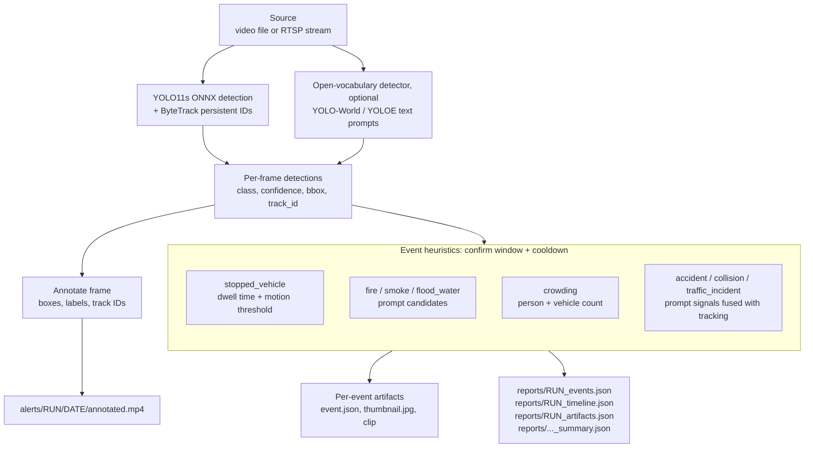

# city-incident-ai

Pretrained-first urban safety demo for local video inference.

This project is intentionally demo-oriented: it runs without mandatory fine-tuning, without a required dataset bootstrap, and without a large backend stack. The main path is pretrained video inference with tracking, event heuristics, and machine-readable outputs for later frontend integration.

## Pipeline



## What This Project Is

`city-incident-ai` is a local Python project for urban safety / city incident demo flows. It focuses on:

- pretrained detection for common urban objects,
- optional open-vocabulary prompts for fire/smoke/flood-like scenes,
- tracking IDs and rule-based event alerts,
- annotated video outputs plus JSON artifacts for UI consumption.

## Current MVP Capabilities

The stable baseline today is:

- pretrained `YOLO11s` video inference via `yolo11s.onnx`,
- optional `YOLO-World` / `YOLOE` open-vocabulary mode,
- Ultralytics tracking,
- stopped-vehicle, fire/smoke, flood/water, and crowding heuristics,
- annotated MP4 output,
- summary JSON, events JSON, timeline JSON, and artifacts JSON.

Incident-enhanced demo is available as an experimental extension for:

- `pothole_candidate`
- `road_damage_candidate`
- `fire_candidate`
- `smoke_candidate`
- `accident_candidate`

Training remains in the repository, but it is not the main demo path for this MVP.

## Quick Start

Linux/macOS:

```bash
bash scripts/bootstrap_env.sh
source .venv/bin/activate
python infer_video.py --config configs/infer_pretrained_yolo11s.yaml --source demo.mp4
```

Windows PowerShell:

```powershell
.\scripts\bootstrap_env.ps1
.\.venv\Scripts\Activate.ps1
python infer_video.py --config configs/infer_pretrained_yolo11s.yaml --source demo.mp4
```

Manual install (what bootstrap does, plus the ONNX runtime pieces the YOLO11s ONNX path needs; Python 3.11/3.12):

```bash
python -m venv .venv && source .venv/bin/activate
pip install -r requirements.txt ultralytics onnx onnxruntime lap
```

If `demo.mp4` does not exist, the run will finish with a skipped summary instead of crashing.

## Demo Modes

Standard pretrained mode:

```bash
python infer_video.py --config configs/infer_pretrained_yolo11s.yaml --source demo.mp4
```

Open-vocabulary mode:

```bash
python infer_video.py --config configs/infer_open_vocab.yaml --source demo.mp4
```

Incident-enhanced mode:

```bash
python infer_video.py --config configs/infer_incidents_pretrained.yaml --source demo.mp4
```

Optional RTSP demo:

```bash
python infer_rtsp.py --config configs/inference_rtsp.yaml
```

Useful CLI overrides:

```bash
python infer_video.py --config configs/infer_open_vocab.yaml --source demo.mp4 --prompts "fire,smoke,flood"
python infer_video.py --config configs/infer_pretrained_yolo11s.yaml --source demo.mp4 --run-name my_demo
python infer_video.py --config configs/infer_pretrained_yolo11s.yaml --source demo.mp4 --report-path reports/my_demo_summary.json
```

## Outputs

Each run writes human-viewable and machine-readable artifacts:

- `alerts/<run_name>/<date>/annotated.mp4`
- `alerts/<run_name>/<date>/predictions.jsonl`
- `alerts/<run_name>/<date>/predictions.csv`
- `alerts/<run_name>/<date>/timeline.csv`
- `alerts/<run_name>/<date>/events.json`
- `reports/<run_name>_summary.json`
- `reports/<run_name>_events.json`
- `reports/<run_name>_timeline.json`
- `reports/<run_name>_artifacts.json`

The summary JSON is the main frontend-friendly entry point.

## Limitations

- Open-vocabulary mode is experimental and may fall back to pretrained YOLO11s if the open-vocabulary model is unavailable.
- Incident-enhanced mode is experimental and should be treated as candidate-level, prompt-based, and heuristic-assisted.
- This is not a fine-tuning-first project anymore.
- The demo path is not intended to be a full production MLOps stack.
- If a source file is missing, the scripts write a skipped report and exit cleanly.

## Frontend Integration Overview

The frontend should treat `reports/<run_name>_summary.json` as the primary run record and use:

- `reports/<run_name>_events.json` for event cards,
- `reports/<run_name>_timeline.json` for per-frame / per-second timelines,
- `reports/<run_name>_artifacts.json` for output paths,
- `alerts/<run_name>/<date>/annotated.mp4` for playback.

See [`docs/FRONTEND_INTEGRATION.md`](docs/FRONTEND_INTEGRATION.md) for the API draft and example payloads.

## Reference Docs

- [`docs/DEMO_GUIDE.md`](docs/DEMO_GUIDE.md)
- [`docs/PROJECT_SUMMARY.md`](docs/PROJECT_SUMMARY.md)
- [`docs/REPO_GUIDE.md`](docs/REPO_GUIDE.md)
- [`docs/FRONTEND_INTEGRATION.md`](docs/FRONTEND_INTEGRATION.md)
