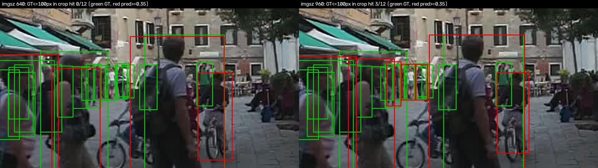
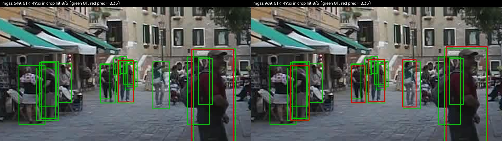
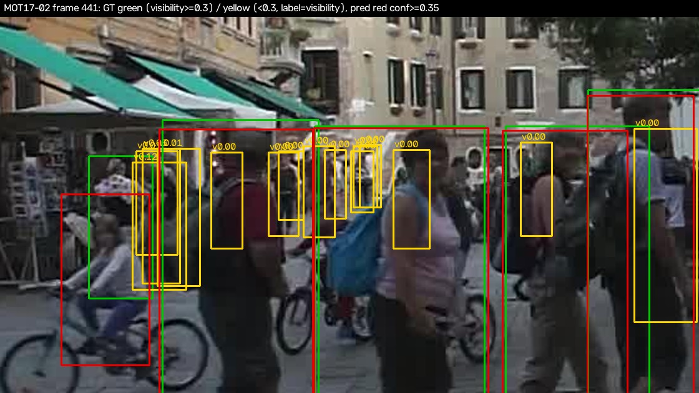
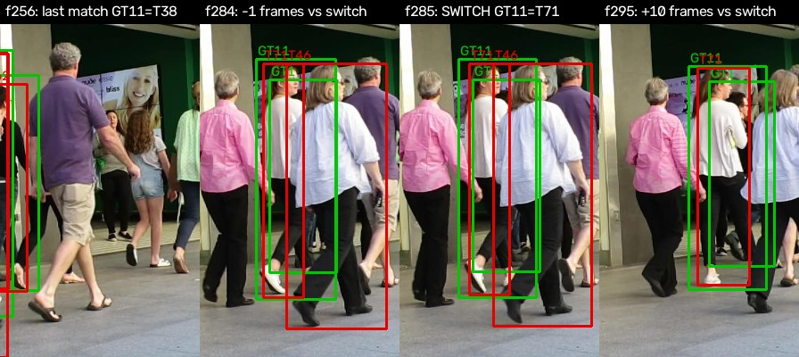
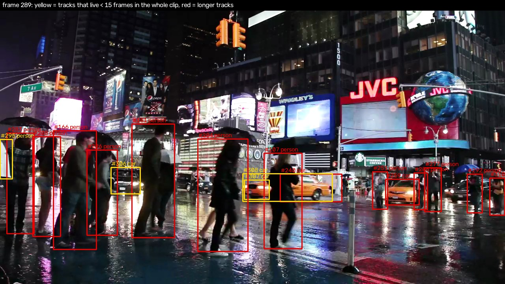
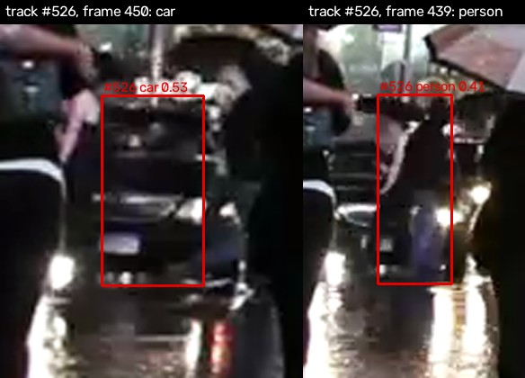
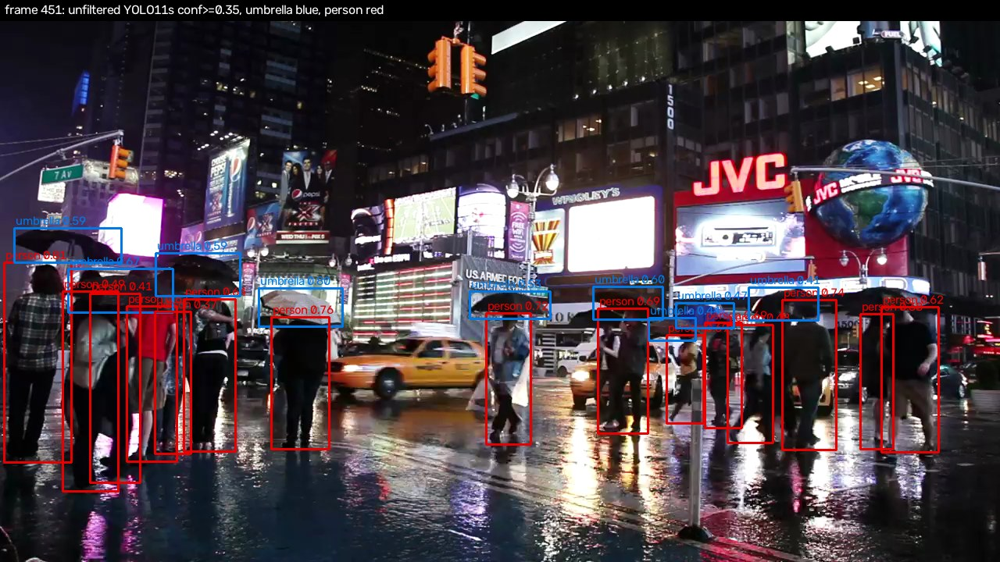
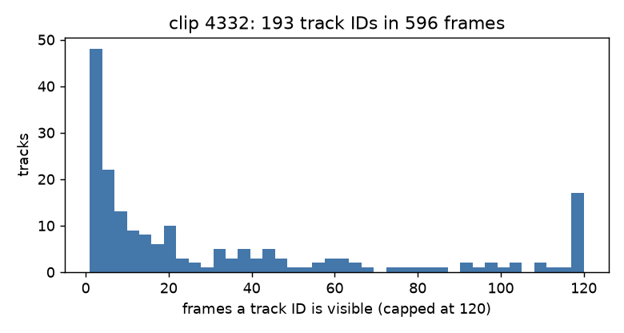
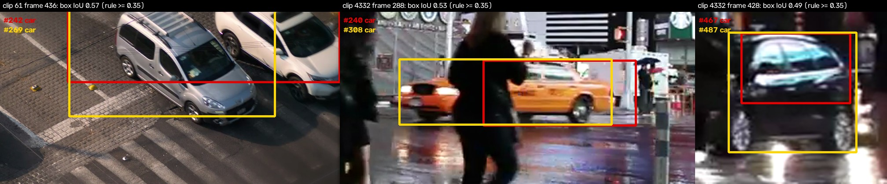

# Error analysis

Five concrete failure cases, each tied to numbers produced by scripts in this repo. Every number below is read from
`reports/metrics/*.json` (`error_analysis.json` is written by `python -m eval.error_analysis`; the other files by the
eval scripts named in the README). The "why" paragraphs are **hypotheses** — they were not tested unless a number says so.
Example frames are chosen by a programmatic rule (stored in `error_analysis.json`), not by eye, except where stated.

Colours: ground truth green, predictions red (conf >= 0.35), GT with visibility < 0.3 yellow.
MOT17 images are the FRCNN folders of MOT17-02/04/09 (person only); "eval frames" = every 5th frame (435 frames).

---

## a) Small / far people (< 50 px): 0 % recall at 640

**Measured** (`speed.json`, `error_analysis.json`; model `yolo11s`, conf 0.35, 14,287 GT persons over the 435 eval frames):

| GT height | imgsz 640 (repo model) | imgsz 960 |
|---|---:|---:|
| < 50 px | 0 / 254 = 0.0 % | 2 / 254 = 0.8 % |
| 50–100 px | 113 / 1,632 = 6.9 % | 246 / 1,632 = 15.1 % |
| model-only p50 latency | 37.7 ms | 124.5 ms (3.3x) |

*MOT17-02 frame 401 (largest 640→960 gain on persons <= 100 px): crop hit 0/12 at 640, 3/12 at 960; in the whole frame the 18 GT persons of 50–100 px go from 0 to 5 hits.*

*MOT17-02 frame 506 (the frame with the most GT < 50 px, 5 of them): 0 hits at 640 and 0 at 960. The heavy 960 cost buys almost nothing below 50 px.*

**Why (hypothesis):** at 640 a 1920x1080 frame is shrunk 3x, so a 40 px person becomes ~13 px, below what the stride-8 head can resolve; 960 only shrinks 2x.
**Fix:** tiled inference (SAHI-style: run the detector on overlapping crops at native resolution and merge with NMS). **Expected cost:** one extra detector pass per tile, so latency grows roughly with the tile count — *not benchmarked here*; the measured reference point is that a single 960 pass already costs 3.3x the 640 pass and still finds only 2 of 254 tiny people. Fine-tuning on small-person data (e.g. CrowdHuman/VisDrone-style) is the other option; cost = labelled data and training time, not measured.

---

## b) Heavy occlusion (visibility < 0.3) in a crowd

**Measured** (`detection.json`, detector alone at conf 0.35; `tracking_conf_ablation.json`, from tracker output):

| GT visibility | detector recall | tracker output, detector conf 0.35 | tracker output, detector conf 0.10 |
|---|---:|---:|---:|
| < 0.3 (22,627 boxes) | 831 / 22,627 = 3.7 % | 3.4 % | 5.2 % |
| 0.3–0.7 (18,826) | 17.1 % | 16.4 % | 21.4 % |
| > 0.7 (30,010) | 64.8 % | 64.2 % | 76.4 % |

*MOT17-02 frame 441 (the eval frame with the most GT of visibility < 0.3): 28 of its 35 GT persons have visibility < 0.3 and 1 of them is hit; of the 7 with visibility >= 0.3, 5 are hit. Yellow labels are the annotated visibility.*

**Why (hypothesis):** a person that is mostly hidden behind others produces a low objectness score and, after NMS at IoU 0.5, overlapping boxes in a dense group suppress each other.
**Fix:** (1) feed the tracker low-confidence boxes — done, measured: recall below 0.3 visibility 3.4 % → 5.2 %, MOTA 29.9 → 35.7, at the price of +815 false positives and +26 ID switches (`tracking_conf_ablation.json`); (2) a crowd-trained detector or a head/upper-body detector (CrowdHuman-style fine-tune; cost = training, not measured). Even with (1), 94.8 % of < 0.3-visibility persons are still missed.

---

## c) An ID switch from the ByteTrack evaluation

**Measured:** re-scoring `reports/metrics/mot_results/bytetrack/` with `error_analysis.py` gives 130 switches, equal to `tracking.json` (ByteTrack, detector conf 0.35, 130 IDsw). Selection rule: among switches with >= 20 matched frames before (old ID) and after (new ID), take the one whose GT box overlaps another GT person the most at the switch frame.

*MOT17-09, GT person 11. The tracker follows it as T38 for 52 matched frames, the last at frame 256; the next match is at frame 285, now with the new ID T71 (63 matched frames after). At the switch frame the GT box has IoU 0.63 with another GT person and its annotated visibility is 0.08. (The crop is fixed at the frame-285 position, so at frame 256 the person is at the crop's left edge.)*

**Why (hypothesis):** the person walked behind another pedestrian (visibility 0.08, IoU 0.63 with them), the detector lost them, and ByteTrack's Kalman prediction no longer matched when they re-emerged, so a new track was started.
**Fix tried:** longer track memory. `track_buffer` 60 instead of 30 gave 157 vs 156 ID switches (no gain, `tracking_conf_ablation.json`), and BoT-SORT with ReID off gave 129 vs 130 (`tracking.json`), so neither motion-only change helps. **Next:** appearance re-identification (ReID embeddings in BoT-SORT). **Expected cost:** an embedding network pass per box; not measured. The tracker itself costs 1.2 ms/frame (ByteTrack) vs 10.0 ms (BoT-SORT) in `tracking_timing.json`, so any ReID budget is on top of that.

---

## d) The rainy-night Times Square clip (mixkit-4332): flicker, class flips, umbrellas

**Measured** (`error_analysis.json`, default demo config on `yolo11s.onnx`; 596 frames; a track is counted per frame in which its ID is drawn at conf >= 0.35):

| Quantity | Value |
|---|---:|
| distinct track IDs | 193 |
| tracks visible < 15 frames | 96 (49.7 %) — but only 454 of 8,047 drawn boxes (5.6 %) |
| median track length | 15 frames |
| tracks with gaps (frames missing inside their lifetime) | 103 |
| tracks that change class | 5, all car/person |
| unfiltered detector, every 10th frame (60 frames): umbrella boxes | 271 boxes, present in 60 / 60 sampled frames |

*d2: yellow = IDs that live < 15 frames in the whole clip. d1: track #526 is "person" (conf 0.41) in frame 439 and "car" (conf 0.53) in frame 450 on a dark, rain-blurred object. d3: the unfiltered detector sees 'umbrella' boxes (blue) on top of the people (red); 'umbrella' is not in the demo's class filter.*

Honest reading: class flips are rare here (5 of 193 tracks), but ID churn is large: half of all IDs are short-lived, which inflates "unique tracks" (193 IDs for what is a continuous flow of pedestrians). I have no ground truth for this clip, so I cannot say how many of the 193 are false.
**Why (hypothesis):** rain, glare and motion blur lower confidence around the 0.35 display threshold, so a person drops in and out of the displayed set; umbrellas hide heads and shoulders, which shifts the box and weakens appearance cues.
**Fix:** (1) report/alert only on tracks older than N frames (zero model cost; adds an N-frame delay to events); (2) smooth the class per track by majority vote (zero cost); (3) a night/rain fine-tune. (3) cost = labelled data, not measured. None of (1)/(2) is implemented yet.

---

## e) The IoU `collision_candidate` rule: overlapping boxes ≠ collision

**What the code does** (`src/infer/runtime.py`, `_update_collision_candidates`): fires when two tracked vehicle boxes (car/bus/truck/motorcycle) have 2D box IoU >= `overlap_iou_threshold` (0.35 in `configs/infer_incidents_pretrained.yaml`) in a single frame, with a cooldown; no speed, no trajectory, no temporal confirmation. It only runs in the `incident_enhanced` mode (YOLO-World); **the default demo config never fires it.**

**Measured** (`error_analysis.json`, pipeline predictions on `yolo11s.onnx`, threshold 0.35): clip 61 has 2 frames with such a pair (2 distinct pairs), clip 4332 has 26 frames (9 distinct pairs).

I looked at the four highest-IoU / most distinct candidates by eye (clip 61 f436; clip 4332 f288, f305, f428). **I did not find an example of two clearly separate cars that overlap by IoU >= 0.35.** What the overlaps actually are:

1. clip 61 f436 (IoU 0.57): one box (#242) spans a silver van *and* the white car beside it, overlapping the box of the van (#269) — a merged detection of two vehicles that are driving normally, no contact visible.
2. clip 4332 f288 (IoU 0.53): one taxi split into two boxes by a pedestrian walking in front of it.
3. clip 4332 f428 (IoU 0.49): two nested boxes on one car.

So every inspected "collision candidate" is a detection artifact (merged, split or duplicated boxes), not two vehicles touching; and in this footage there is no collision. (Frame 3 of clip 4332 has a car/truck pair at IoU 0.95; I did not inspect it, but IoU that high suggests a duplicate.)
**Why (hypothesis):** box overlap in a 2D, perspective view mixes depth ordering with proximity: a car behind another overlaps in the image without touching, and detector artifacts add more overlaps.
**Fix:** require the pair to persist for several frames *and* a sudden change in relative velocity, class-aware duplicate suppression across vehicle classes, and ideally ground-plane positions (a per-camera homography). **Expected cost:** per-camera calibration for the homography; the frame-persistence and velocity checks are free at inference. No event-level ground truth exists yet to measure precision/recall of any of this.

---

## Debugging note: INT8 gave AP50 = 0.000

`reports/metrics/int8_debug.json` (`python -m eval.int8_debug`; same frame and accuracy protocol as the speed benchmark):

| Model | box rows min–max (px) | max class score | distinct class-score values | AP50 |
|---|---|---:|---:|---:|
| FP32 | 2.86 – 637.20 | 0.818 | 5,883 | 0.550 |
| INT8, whole graph quantized | 2.60 – 638.13 | 0.000 | 1 | **0.000** |
| INT8, detect-head decode kept FP32 | 2.83 – 636.63 | 0.803 | 272 | 0.549 |

**Cause:** the YOLO11 ONNX output is a single `(84, 8400)` tensor whose first 4 rows are box coordinates in pixels (0–640) and whose other 80 rows are class scores (0–1). With the whole graph quantized, that concatenation gets one INT8 activation scale chosen for the 0–640 range, so every class score rounds to 0 (1 distinct value) while the boxes look fine. Preprocessing and calibration data were not the problem (dynamic INT8 and the fixed static INT8 both reach ~0.55).
**Fix:** keep the detect-head decode (DFL, box arithmetic, concat, sigmoid; 25 nodes) in FP32 via `nodes_to_exclude`. Lesson: always compare raw output ranges against FP32 before trusting a quantized model's accuracy number — the failure was visible as `max class score = 0.0`, not as a subtle drop.
